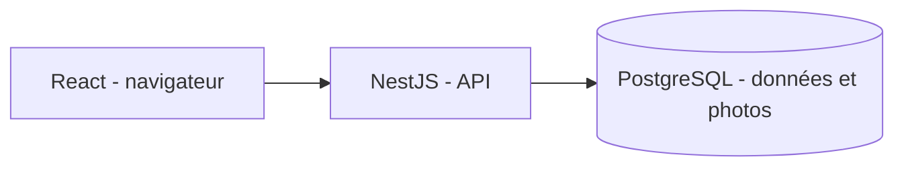

# ADR-006 — Socle du pilote
Statut : orientations confirmées, modalités techniques proposées.

## Architecture retenue
Web React/TypeScript, backend NestJS, PostgreSQL sans S3, fonctionnement en ligne. Le monolithe modulaire reste la proposition d’organisation. Le pilote est au Cameroun.

## Photos dans PostgreSQL
Proposition : Evidence porte les métadonnées ; EvidenceBlob porte un bytea, référencé par blob_id. Le binaire est chargé seulement lors d’un téléchargement autorisé, jamais dans les listes. Enregistrement des métadonnées et du contenu dans une même transaction.
Contrôler le type réel, les dimensions et le poids avant et après traitement. Limite proposée de 5 Mio par photo normalisée ; formats JPEG/PNG/WebP ; suppression des métadonnées inutiles. Les limites restent à vérifier avec les besoins terrain.
Réponses privées, sans cache partagé, avec type contrôlé et nosniff. Aucun lien public ni bucket.
Avantage : une seule persistance et un ensemble de sauvegardes au pilote. Coût : taille de base, temps de sauvegarde/restauration et mémoire augmentent ; mesurer le volume photo avant généralisation.
Les descriptions de stockage objet/S3 des anciennes annexes sont des alternatives remplacées par cette décision, et non des dépendances à installer.

## Identité et comptes
Mot de passe pour tous. Invitations pour clients et prestataires. Ajout direct des agents par responsable prestataire, identifiant sans courriel obligatoire. Proposition : secret initial aléatoire, changement obligatoire et réinitialisation tracée ; aucun mot de passe commun.
Fonction de dérivation dédiée avec sel, paramètres adaptés et comparaison sûre. Sessions révocables ; limitation des essais ; récupération sécurisée du compte propriétaire. Le détail MFA administrateur reste à mettre en œuvre.
Une personne peut avoir plusieurs appartenances. Chaque requête utilise un contexte serveur actif, avec rôles/site contrôlés. La politique du premier lot évalue une capacité active ; le futur résolveur d’identité doit permettre les rôles cumulés sans mélanger les organisations.

## Récurrence proposée
Séries quotidiennes, hebdomadaires et mensuelles ; fuseau du site, date de début et fin ou horizon de génération borné. Le client crée la série ; les occurrences sont des interventions indépendantes affectées par le prestataire.
Unicité série/instant d’occurrence pour empêcher les doublons au rejeu. Une modification ne change jamais l’historique. Portée explicite : occurrence seule ou occurrences futures non commencées.
À détailler : date mensuelle inexistante, exceptions et horizon. Les conflits horaires restent bloquants pour chaque agent, y compris lors d’une modification.

## Conservation
Deux horloges : conservation des données et accès après contrat. Le porteur a annoncé 9 mois pour les deux ; leur point de départ doit être précisé pour éviter une purge qui détruirait un historique encore accessible. Aucune purge automatique avant décision sur catégories, cas actifs, exports et sauvegardes.
Cette durée n’est pas présentée comme une obligation juridique.

## Lot de développement initial
API NestJS, configuration contrôlée, pool PostgreSQL, sondes liveness/readiness et politique métier pure avec tests.
Pas encore d’authentification, de schéma métier, de frontend ou d’endpoints métier. Les règles testées devront être reliées aux transactions et à une identité fiable avant exposition. La politique d’affectation initiale ne remplace pas la future commande de remplacement d’agent.
Validation locale : 11 tests passent, compilation comprise. Readiness négative vérifiée par HTTP ; readiness positive et transactions PostgreSQL restent à vérifier sur une base réelle.
