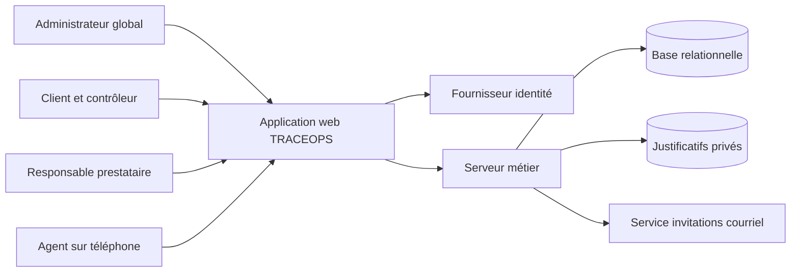
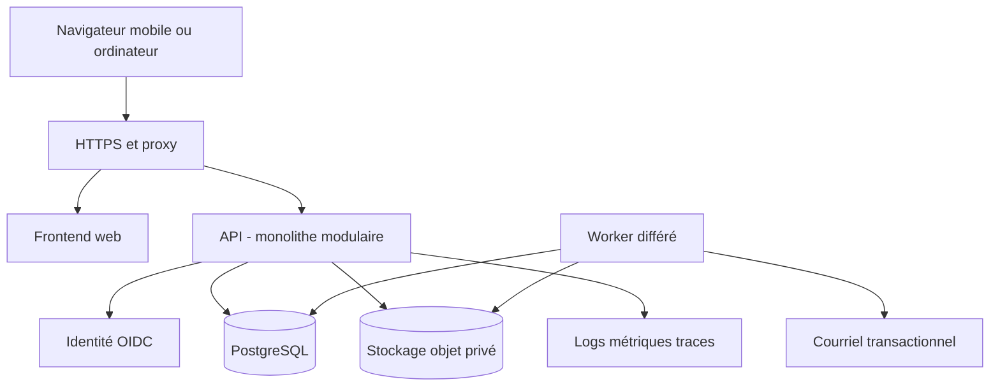
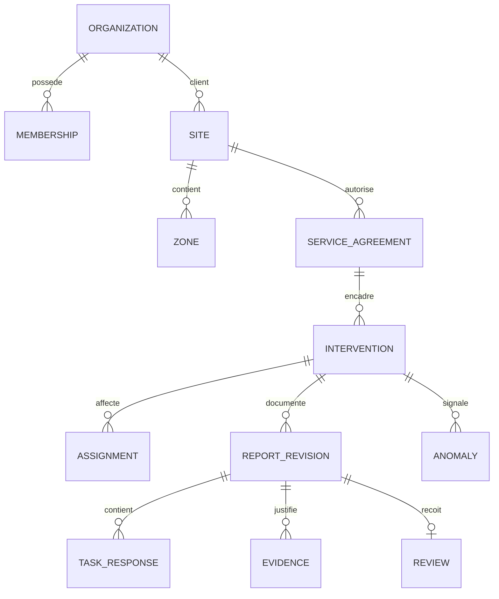
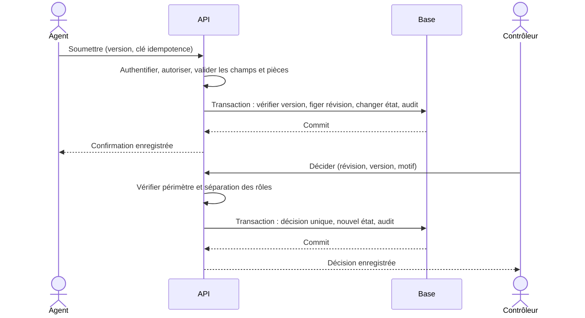

# TRACEOPS — Software Architecture Document

> Version 0.2 — 3 novembre 2026 — Projet de travail, non approuvé.
> Source : « TRACEOPS — Présentation du projet et cadrage fonctionnel initial », v0.1, fichier fourni par le porteur du projet.
> Convention : **[S]** = explicitement décrit dans la source ; **[P]** = proposition à valider ; **[O]** = question ouverte. Une proposition ne constitue pas une décision approuvée.

## 1. Statut et démarche
[P] Architecture proposée pour un premier pilote ; aucune technologie n’est imposée par la note source et aucune infrastructure n’a été déployée.
La démarche distingue besoins métier, attributs de qualité, limites de confiance, compromis, livraison et exploitation. La [roadmap Software Architect](https://roadmap.sh/software-architect) sert de repère d’apprentissage ; elle ne constitue ni une spécification TRACEOPS ni une obligation d’adopter toutes les technologies qu’elle évoque.
[P] Le choix final dépend de l’équipe, du budget, du réseau terrain, des volumes et de l’hébergement. Les décisions ci-dessous sont des ADR proposés, pas des accords acquis.

## 2. Facteurs déterminants
1. Isolation client–prestataire–agent et protection des justificatifs.
2. Cohérence transactionnelle du compte rendu, du contrôle et de l’historique.
3. Interface web adaptée au téléphone, avec connectivité réelle encore inconnue.
4. Petite première version exploitable par une équipe dont la taille reste inconnue.
5. Évolution des prestations et règles sans réécriture de l’historique.

## 3. Contexte

[P] L’identité authentifie ; le serveur TRACEOPS décide des droits métier. Les services courriel et identité sont des dépendances externes à surveiller.

## 4. Architecture logique proposée
**ADR-001 — Monolithe modulaire avec base relationnelle.**
Choix : un backend déployable unique, découpé en modules métier, et un worker si nécessaire pour les traitements différés.
Motif : transactions simples pour transitions et audit, coût opérationnel limité et refactorisation possible.
Alternatives : microservices écartés au départ faute de besoin d’indépendance de déploiement démontré ; backend sans séparation métier écarté pour éviter le couplage diffus.
Conséquence : mise à l’échelle globale du backend ; frontières et contrats internes doivent rester explicites.

| Module | Responsabilité | Données dont il est propriétaire |
|---|---|---|
| IdentityAccess | Appartenances, rôles et décisions d’accès | Membership, habilitations |
| Organizations | Organisations et relations de service | Organization, ServiceAgreement |
| Sites | Sites et zones | Site, Zone |
| ServiceCatalog | Prestations et versions des tâches | TaskTemplateVersion |
| Operations | Planning, affectations, transitions et comptes rendus | Intervention, Assignment, ReportRevision |
| Quality | Contrôles, reprises et anomalies | Review, Anomaly |
| Evidence | Dépôt, vérification et accès aux pièces | Evidence |
| Reporting | Listes et agrégats autorisés | Projections dérivées si utiles |
| Audit | Événements applicatifs | AuditEvent |
[P] Les modules utilisent les services applicatifs des autres modules pour leurs écritures. Les opérations critiques partagent une transaction de base ; pas d’appel réseau obligatoire au milieu d’une validation.

## 5. Conteneurs et stack candidate

[P] Candidats à confirmer : TypeScript côté interface et serveur, React pour l’interface, NestJS pour un backend structuré, PostgreSQL pour les données, stockage objet compatible S3, fournisseur OIDC pour l’identité.
[P] Alternative valide si l’équipe la maîtrise mieux : Django ou Laravel avec les mêmes frontières, invariants et contrats. Éviter une décision fondée seulement sur la popularité.
[O] Versions, licences, compatibilités, coût fournisseur et support devront être vérifiés dans les documentations officielles au moment du choix. Aucun numéro de version n’est engagé ici.
[P] Frontend et API sous une même origine ; sessions serveur et cookies sécurisés. Aucun jeton longue durée stocké dans localStorage.

## 6. Modèle d’isolation et données
**ADR-002 — Schéma partagé, contexte métier explicite et contrôle systématique.**
[P] Organisation n’est pas synonyme automatique de tenant : une intervention associe un client et un prestataire. Le client constitue le propriétaire du contexte opérationnel ; l’accès du prestataire est une autorisation bornée à la relation et au site.
[P] Chaque ressource métier porte client_id et, selon sa nature, provider_id et site_id. L’API obtient les appartenances depuis l’identité authentifiée ; elle vérifie chaque contexte demandé. Elle n’accepte pas un client_id envoyé sans vérification.
[P] Requêtes filtrées côté serveur, contraintes de cohérence, tests adverses, puis politiques PostgreSQL RLS pour les tables sensibles comme défense supplémentaire. Le contexte RLS doit être fixé localement à la transaction et réinitialisé via le pool ; le rôle d’exécution ne contourne pas les politiques.
[P] Les migrations utilisent un rôle distinct. Les tâches différées doivent inclure et revérifier leur périmètre ; aucun worker global ne sert de contournement aux contrôles.
[P] Objets privés : métadonnées autorisées en base ; URL signée courte, cinq minutes proposées, émise seulement après vérification. Révocation immédiate bloque toute nouvelle URL ; une URL déjà délivrée demeure utilisable jusqu’à expiration. Si ce délai est inacceptable, servir les pièces via proxy authentifié.
[O] Base par client à reconsidérer si isolation contractuelle, résidence ou restauration individuelle l’exigent.

### Administration globale demandée par le porteur
[S] Une vue prestataire et une vue administrateur contrôlant toute la plateforme sont requises.
[P] La console globale est une partie du frontend avec routes serveur dédiées ; masquer un menu ne suffit pas. IdentityAccess reconnaît un rôle de plateforme explicite, provisionné par une procédure sécurisée. Les services métier distinguent autorisation locale et autorisation globale, puis appliquent les mêmes invariants.
[P] RLS doit prévoir un chemin global explicite et vérifié côté serveur, avec un rôle de base borné et des politiques dédiées ; ne pas activer BYPASSRLS pour les requêtes web. Le contexte global ne vient jamais d’un paramètre client de confiance.
[P] L’administrateur peut consulter les périmètres et décider, sans usurper un utilisateur ni modifier les versions soumises. Conserver acteur global, contexte cible et motif ; MFA, durée de session limitée et alerte sur attribution du rôle.
[O] Identifier qui détient ce pouvoir et qui approuve l’ajout d’un nouvel administrateur global. La perte du dernier compte global exige une procédure de récupération documentée.

## 7. Données et relations

[P] Les versions attendues et soumises sont conservées séparément. Index proposés : client/site/date, prestataire/date/état, agent/affectation active, anomalies par état et responsable, événements par ressource/date.
[P] Horodatage serveur ; identifiants UUID ; contraintes étrangères et unicité de la décision par révision ; concurrence optimiste par version.

## 8. Transaction critique : soumettre puis contrôler

[P] Le statut ne change pas si l’écriture de l’audit échoue. Un contrôle simultané utilise une condition sur version et état ; une seule transaction gagne.
[P] Courriels et notifications ne conditionnent pas le commit. Si nécessaires, une outbox transactionnelle conserve le travail à livrer ; worker avec reprises, déduplication, plafond de tentatives et file d’échecs. Pas de promesse « exactement une fois » pour un système externe.

## 9. Pièces justificatives
[P] Dépôt en zone privée de quarantaine avec taille/type bornés. Validation du type réel, décodage et réencodage des images, suppression des métadonnées EXIF, analyse antimalware selon les formats admis. Seules les pièces prêtes peuvent être jointes à une soumission.
[P] Les dépôts orphelins expirent après une durée courte configurable. Un traitement échoué reste visible comme erreur et ne devient pas une preuve utilisable. Aucun bucket public ; noms d’objets générés ; noms fournis par l’utilisateur jamais utilisés comme chemin.
[O] Photographies obligatoires, durée de conservation et règles sur personnes/locaux sensibles à valider avec le pilote.

## 10. Réseau et hors ligne
**ADR-003 — Saisie en ligne pour le MVP, sous réserve du terrain.**
Motif : synchronisation, révocation sur appareil et conflits augmentent fortement le périmètre.
Conséquence : après perte réseau, sauvegarde signalée comme échouée ou en attente de confirmation ; pas de soumission locale présentée comme validée serveur.
[P] Si hors ligne indispensable : nouvelle ADR et extension SRS pour cache chiffré ou minimisé, durée de vie, files de commandes, identifiants idempotents, reprise des transferts, règles de conflits, révocation différée et effacement à la déconnexion. Évaluer les appareils partagés avant toute persistance locale.

## 11. Sécurité et menaces principales
| Menace | Mesure proposée | Preuve attendue |
|---|---|---|
| Accès par identifiant d’un concurrent | Autorisation objet et contexte à chaque endpoint | AT-04 et tests de pièces |
| Élévation de rôle | Affectation de rôles contrôlée, MFA privilégiée, audit | Tests d’invitation et de modification de rôle |
| Photo exposée ou malveillante | Stockage privé, liens courts, quarantaine | AT-12 et vérification stockage |
| Double soumission ou contrôle concurrent | Idempotence, version et contrainte unique | AT-05 |
| Altération historique | Écritures append-only côté application, accès base limité | Revue de droits, tests d’immuabilité |
| Vol de session / requête forgée | TLS, cookies sécurisés, CSRF, expiration et révocation | Tests d’authentification |
| Secrets et données dans les logs | Gestionnaire de secrets, filtrage, minimisation | Revue de logs et scan dépôt |
[P] Les administrateurs de base restent techniquement puissants : l’audit applicatif ne fournit pas à lui seul une preuve inviolable. Si exigence probatoire, définir journal externe et conservation appropriée.
[O] Aucune conformité juridique ou certification ne peut être affirmée avant identification du pays, des contrats et des traitements.

## 12. Déploiement et exploitation
[P] Environnements distincts développement, recette et production ; données fictives en développement. Déploiement conteneurisé ou plateforme gérée, base gérée si budget compatible ; Kubernetes n’est pas une dépendance initiale.
[P] Pipeline : vérifications de types et lint → tests métier → tests d’intégration base et isolation → parcours E2E critiques → analyse de dépendances/secrets → build immuable → recette → décision de mise en production.
[P] Migrations compatibles en deux temps si possible : ajouter puis migrer puis retirer ultérieurement. Une migration destructive n’est pas annulée par un simple retour de version applicative.
[P] Sauvegardes chiffrées de base et pièces, rétention distincte de la conservation métier, restauration testée. Objectifs initiaux du SRS : RPO 24 h, RTO 8 h ; à durcir si le pilote l’exige.
[P] Alertes : erreurs API, latence, échecs de sauvegarde, saturation stockage, retards worker et échecs d’envoi d’invitation. Corrélation sans textes libres sensibles. Runbooks pour accès bloqué, incident d’isolation, perte de données et restauration.
[P] Déploiement par une personne habilitée avec procédure de retour arrière testée. Ce document n’autorise aucun achat ni déploiement.

## 13. Performance, coûts et évolution
[P] Commencer par index, pagination et requêtes contrôlées ; calcul synchrone simple des tableaux de bord. Introduire projections, cache ou service séparé uniquement après mesure.
[P] Drivers de coût : utilisateurs actifs, photos/jour × taille × conservation, trafic de téléchargement, sauvegardes et services identité/courriel. Aucun budget mensuel crédible sans ces données.
[P] Extraire un service seulement si charge, besoin d’isolation ou cadence d’évolution indépendante le justifie. Ne pas distribuer le workflow transactionnel sans plan de cohérence et de reprise.
[O] Aucun benchmark, audit sécurité ou test de restauration n’a été exécuté : leurs résultats constituent des conditions de livraison futures.

## 14. Décisions d’architecture proposées
| ADR | Choix | Réévaluer si |
|---|---|---|
| ADR-001 | Monolithe modulaire + PostgreSQL | Besoin démontré de déploiements ou charges indépendantes |
| ADR-002 | Schéma partagé, autorisation contextuelle et RLS | Exigence d’isolation ou de résidence dédiée |
| ADR-003 | MVP en ligne | Réseau pilote incompatible avec l’usage |
| ADR-004 | Versions immuables des attendus et comptes rendus | Aucun assouplissement sans maintenir l’audit |
| ADR-005 | Objets privés, dépôt vérifié et accès temporaire | Révocation immédiate ou exigences de preuve plus fortes |
[P] Chaque ADR final devra nommer son décideur, sa date d’acceptation, les alternatives et les conséquences retenues.

## 15. Référentiel détaillé intégré — v0.2
Le [Référentiel détaillé de conception et d’architecture](REFERENTIEL_ARCHITECTURE.md) fait partie intégrante de ce document. Ses 18 chapitres explicitent les notions de la roadmap et leurs conséquences pour TRACEOPS : niveaux d’architecture, responsabilités, conception, langages, données, sécurité, intégrations, interfaces, réseaux, exploitation, outils, gouvernance, agilité et systèmes d’entreprise.

La [matrice de couverture](COUVERTURE_CONCEPTS.md) permet de retrouver chaque notion. Les alternatives étudiées et différées restent documentées ; leur présence n’en fait pas des dépendances du système.

### Processus de décision proposé
Relier chaque ADR à une exigence BRS/SRS ; comparer options et contraintes ; définir prototype ou preuve ; enregistrer décideur et statut ; réexaminer selon un événement mesurable. Les cibles de performance, volumes et coûts doivent être confirmées par le pilote et des mesures avant engagement.

### Scénarios structurants
Les séquences détaillées du chapitre 17 couvrent réponse perdue après soumission, contrôle concurrent, suspension globale et fraîcheur des tableaux de bord. Elles relient principes théoriques, règles métier et tests attendus. Le chapitre 18 définit les preuves à réunir avant réalisation, pilote et généralisation.
