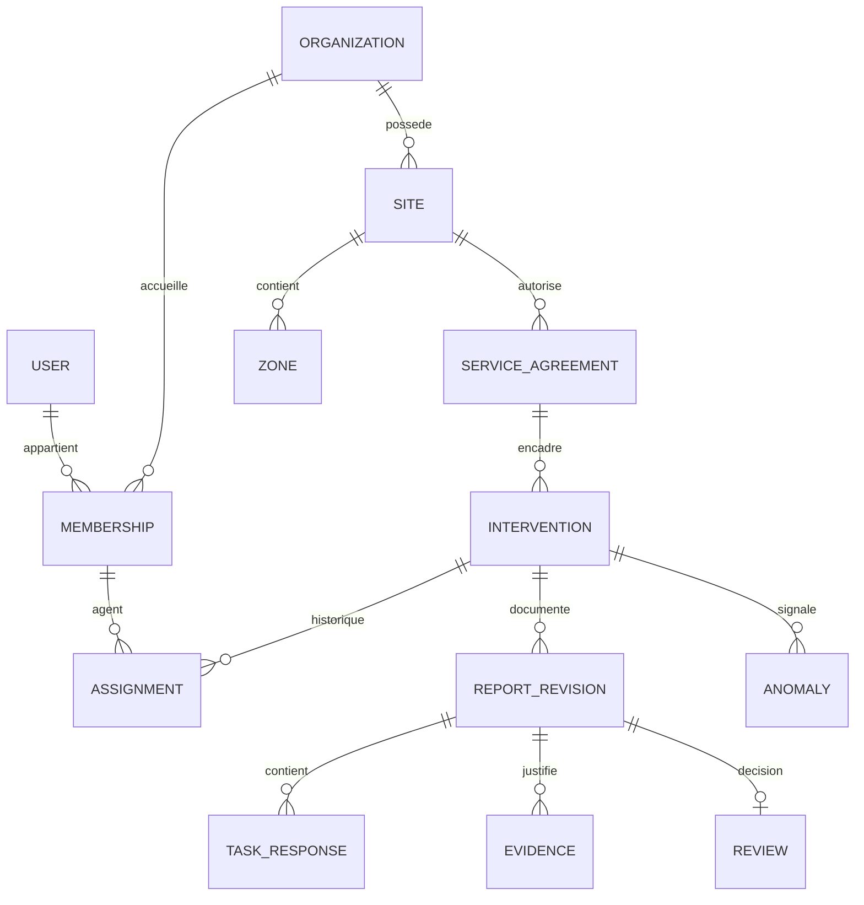

# TRACEOPS — Modèle de données et invariants
Version 0.1 — Conception proposée, avant implémentation.

## 1. Règles confirmées et portée
DEC-001 : backend NestJS. DEC-002 : contrôle direct par le client. DEC-003 : création par le client. DEC-004 : affectation par le responsable prestataire, réalisation et soumission par l’agent ; circuit confirmé par le porteur.
Les structures techniques suivantes sont proposées [P]. PostgreSQL reste le candidat de base relationnelle ; aucun schéma n’a encore été déployé.

## 2. Relations principales

Une organisation prestataire peut travailler avec plusieurs clients. Un client peut travailler avec plusieurs prestataires. L’accord sur un site borne leur collaboration ; appartenir à un prestataire ne donne pas accès à tous les sites de ses clients.

## 3. Conventions proposées
Identifiants UUID ; instants serveur en UTC ; fuseau IANA sur le site ; version entière pour concurrence optimiste ; clés étrangères et contraintes en base. Les heures prévues et les heures constatées sont distinctes.
Les champs client_id, provider_id et site_id servent au contrôle de cohérence. Leur répétition ne doit jamais permettre des combinaisons contradictoires : clés étrangères composites ou contrôles transactionnels documentés.
Les données historiques importantes sont archivées ou versionnées. Aucun soft delete générique ne remplace une politique de conservation. Un champ JSON ne doit pas contenir des identifiants non contrôlés permettant de contourner l’isolation.

## 4. Dictionnaire de données

### User — personne authentifiée
Champs : id, identity_issuer, identity_subject, display_name, state, created_at.
Contrainte : identité externe unique par couple issuer/subject. L’adresse courriel peut évoluer et ne constitue pas la clé métier.
Ne pas stocker les mots de passe si l’authentification est déléguée. Suspension et suppression sont distinctes.

### Organization — client ou prestataire
Champs : id, type, name, state, created_at, archived_at éventuel.
Types proposés : CLIENT et PROVIDER. Le cas d’une même entité ayant les deux activités reste ouvert ; ne pas mélanger ses droits automatiquement.
Une suspension interdit les nouvelles opérations selon la politique d’accès, mais conserve les relations historiques.

### Membership et SiteGrant — appartenance et habilitation
Membership : id, user_id, organization_id, role, state, joined_at, revoked_at.
SiteGrant : membership_id, site_id, capability, state.
Rôles métier : CLIENT_MANAGER, CLIENT_CONTROLLER, PROVIDER_MANAGER, FIELD_AGENT. Proposition : plusieurs capacités explicites possibles sans cumuler automatiquement tous les droits.
Le rôle global PLATFORM_ADMIN est une habilitation plateforme séparée, jamais un champ libre modifiable sur son propre profil.
Contraintes : appartenance active ; site cohérent avec l’organisation ou sa relation autorisée ; acteur réel préservé lors des actions globales.

### Site et Zone — localisation
Site : id, client_id, name, timezone, address facultative, state.
Zone : id, site_id, parent_zone_id éventuel, name, type facultatif, state.
Un parent doit être du même site ; cycles interdits. La suppression d’un site ou d’une zone utilisés doit être remplacée par archivage, sauf procédure de conservation explicitement approuvée.
Une intervention peut cibler tout le site : zone_id facultatif proposé.

### ServiceAgreement — prestation convenue sur un site
Champs : id, client_id, provider_id, site_id, name, starts_at, ends_at éventuel, state.
Il représente la relation opérationnelle et son périmètre ; il ne constitue pas un module de facturation.
Contraintes : client propriétaire du site ; organisation prestataire du type autorisé ; période cohérente ; relation active à la création et à l’affectation.
La fin d’accord bloque les nouvelles opérations selon RG-09 du SRS ; les règles d’accès historique restent à décider.

### TaskTemplateVersion — version de l’attendu
Champs : id, agreement_id, version_number, title, instructions, published_at, state.
TaskDefinition : id, template_version_id, position, label, required, evidence_policy.
Une version publiée ne change pas silencieusement. La création d’intervention copie l’attendu dans un instantané comprenant identifiants de tâche, libellés, consignes et politique de preuve.
Une intervention historique doit rester lisible même si le modèle est ensuite archivé.

### Intervention — unité de travail demandée
Champs : id, client_id, provider_id, site_id, zone_id facultatif, agreement_id, created_by_membership_id, expected_snapshot, scheduled_start, scheduled_end, status, version, created_at, submitted_at éventuel, validated_at éventuel.
Créateur : client habilité. Le serveur déduit et vérifie le contexte ; il n’accepte pas aveuglément les identifiants transmis.
Contraintes : début avant fin ; accord et zone cohérents ; état appartenant à la machine définie dans le SRS.
Une seule colonne de statut n’explique pas toutes les dimensions : retard calculé séparément, anomalies indépendantes et affectation historisée.
[P] L’instantané devient figé à la publication de la mission ; modification ultérieure par le client uniquement via une procédure versionnée à préciser.

### Assignment — affectation et historique
Champs : id, intervention_id, agent_membership_id, assigned_by, active_from, active_until éventuel, reason éventuel.
Le responsable prestataire affecte un agent actif de son organisation. Proposition MVP : un agent responsable courant ; index unique partiel sur intervention_id quand active_until est nul.
Réaffectation : clôturer l’affectation courante et créer la nouvelle dans la même transaction. Conserver l’auteur des rapports existants ; ne jamais attribuer leur travail au nouvel agent.
L’accès historique de l’ancien agent reste ouvert à arbitrage ; refus par défaut après retrait d’affectation, sauf droit explicitement accordé.

### ReportRevision et TaskResponse — réalisation déclarée
ReportRevision : id, intervention_id, revision_number, author_membership_id, state, observation, created_at, submitted_at, version.
TaskResponse : report_revision_id, task_snapshot_id, outcome, reason éventuel.
Contrainte : numéro unique par intervention ; une réponse par tâche ; tâche appartenant à l’instantané de cette intervention.
Brouillon modifiable par l’agent affecté ; révision soumise immuable. Une reprise ouvre une nouvelle révision et conserve la précédente.
Une tâche IMPOSSIBLE exige un motif et une anomalie liée selon RG-04. Elle ne devient jamais EFFECTUEE automatiquement.

### Evidence — photographie ou pièce
Champs : id, client_id, intervention_id, report_revision_id, task_snapshot_id éventuel, object_key, media_type, size_bytes, checksum, security_state, created_by, created_at.
États proposés : UPLOADING, QUARANTINED, READY, REJECTED.
Une soumission ne référence que des pièces READY du même périmètre. La clé objet est générée côté serveur ; aucune URL publique permanente n’est conservée comme droit d’accès.
La base et le stockage objet n’ont pas de transaction commune : prévoir nettoyage des uploads abandonnés, confirmation du dépôt et détection des objets manquants.

### Review — décision du client
Champs : id, report_revision_id, reviewer_membership_id, decision, reason, decided_at.
Décisions : VALIDATED ou REWORK_REQUESTED. Motif obligatoire pour reprise.
Contrainte : une décision par révision soumise ; contrôleur client habilité ; version actuelle ; absence d’autovalidation. Le responsable prestataire ne possède pas ce droit par son rôle métier.
Une nouvelle décision après reprise concerne la nouvelle révision ; aucune réécriture de la décision précédente.

### Anomaly — problème à traiter
Champs : id, intervention_id, task_snapshot_id éventuel, opened_by, description, responsible_membership_id éventuel, status, resolution_note éventuelle, opened_at, resolved_at, closed_at.
Les états et responsabilités suivent le SRS. Une validation d’intervention ne clôture pas implicitement les anomalies.
Pour une tâche impossible, prévenir les doublons créés par réessai de la même soumission.

### AuditEvent — historique des actions
Champs : id, actor_user_id, actor_membership_id éventuel, actor_platform_role éventuel, client_id, resource_type, resource_id, action, occurred_at, correlation_id, reason éventuel, changes limités.
L’acteur réel est conservé, y compris administrateur global. Éviter secrets, photos et copies excessives de texte libre dans l’audit.
La transition métier et son événement sont atomiques. L’audit applicatif n’est pas une garantie d’inviolabilité face à un administrateur de base.

### IdempotencyRecord et OutboxEvent — données techniques
IdempotencyRecord : actor_id, context_id, command, key, request_hash, state, response_reference, expires_at.
Contrainte unique sur le périmètre complet de clé ; corps différent avec même clé refusé. La durée de rétention doit dépasser la fenêtre de réessai autorisée.
OutboxEvent, si effets différés nécessaires : event_id, type, schema_version, context, resource_reference, occurred_at, attempt_count, next_attempt_at, delivered_at.
Une outbox n’autorise pas un export après retrait de droits : revérifier l’autorisation au traitement et au téléchargement.

## 5. Transactions et concurrence
| Commande | Écritures atomiques | Protection |
|---|---|---|
| Créer | Intervention, instantané, audit | Client habilité, cohérence accord/site, clé idempotente si utilisée |
| Affecter | Ancienne affectation clôturée, nouvelle créée, état/version, audit | Un responsable courant ; membre actif du bon prestataire |
| Soumettre | Révision figée, état/version, anomalies nécessaires, audit, outbox éventuelle | Version attendue, complétude, pièces READY, idempotence |
| Contrôler | Décision, état/version, audit, outbox éventuelle | Client habilité, unicité décision/révision, version attendue |
| Demander reprise | Décision motivée, état/version, audit | La révision soumise reste immuable |
Une erreur annule les écritures métier de la transaction ; elle ne supprime pas rétroactivement un fichier déjà déposé.

## 6. Index et volumétrie à valider
Index candidats : intervention(client_id, scheduled_start), intervention(provider_id, status, scheduled_start), assignment(agent_membership_id, active_until), review(report_revision_id) unique, report_revision(intervention_id, revision_number) unique, audit(resource_type, resource_id, occurred_at).
Ne pas indexer chaque champ : mesurer les plans de requête et le coût des écritures. Utiliser les hypothèses de charge du SRS pour les premiers essais ; volumes réels et conservation restent inconnus.

## 7. Recette du modèle
MD-01 : insertion d’une zone d’un autre site rejetée.
MD-02 : affectation simultanée de deux responsables ne laisse qu’une affectation active.
MD-03 : modification d’un modèle ne modifie pas l’attendu historique.
MD-04 : deux contrôles concurrents produisent une seule décision.
MD-05 : réaffectation ne change pas l’auteur d’un rapport.
MD-06 : photo d’un autre contexte refusée.
MD-07 : retry de soumission ne duplique ni rapport ni anomalie.
MD-08 : restauration permet de détecter chaque référence de pièce sans objet.
Ces cas sont des spécifications de tests futurs ; aucun n’a encore été exécuté.

## 8. Décisions encore ouvertes
Modifications après publication, états autorisant replanification/annulation, accès historique de l’ancien agent, conservation et hors ligne. Les responsables de replanification/annulation et le pouvoir exceptionnel de l’administrateur sont confirmés par DEC-005 à DEC-007. Les choix proposés ci-dessus pourront évoluer sans remettre en cause le circuit métier confirmé.

## Décisions DEC-005 à DEC-007 — confirmées par le porteur
- **DEC-005 — Replanification :** le prestataire demande un changement de créneau ; le client confirme. La demande seule ne modifie pas le planning en vigueur.
- **DEC-006 — Annulation :** le client décide ; le prestataire peut demander l’annulation, sans l’exécuter lui-même.
- **DEC-007 — Administration exceptionnelle :** l’administrateur global peut intervenir exceptionnellement pour un client, notamment créer ou valider, avec motif obligatoire et historique de l’acteur réel. Les règles d’intégrité, de version et d’interdiction d’autovalidation continuent de s’appliquer.
Les états permettant ces actions, les délais de réponse et les modalités de notification restent des précisions à finaliser. Ces décisions ne permettent pas de réécrire un compte rendu soumis ou une décision historique.

### ChangeRequest — demande de changement proposée
Champs : id, intervention_id, requested_by_membership_id, type (RESCHEDULE ou CANCEL), reason, proposed_start/proposed_end pour replanification, base_intervention_version, status, decided_by_user_id éventuel, decision_reason éventuel, created_at, decided_at.
États proposés : PENDING, ACCEPTED, REJECTED, WITHDRAWN. L’état de demande est distinct de celui de l’intervention. Une demande ne modifie ni créneau ni état métier ; acceptation et effet s’enregistrent atomiquement, avec vérification du périmètre et de la version. Le rejet conserve le planning initial. Une demande obsolète doit être revue au lieu d’écraser une modification plus récente.
