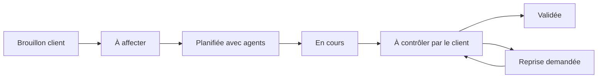

# TRACEOPS — conception produit et expérience utilisateur

Version de travail du 4 novembre 2026. Proposition de refonte, pas description de fonctionnalités déjà livrées. Les hypothèses nécessitent des essais avec les utilisateurs du pilote. Aucun entretien terrain n’est prétendu réalisé.

## 1. But et périmètre

TRACEOPS aide un client à organiser une intervention sur un lieu précis, un prestataire à affecter les bons agents et un contrôleur du client à vérifier le travail effectué. La réussite est une intervention comprise, réalisée, documentée puis validée avec une responsabilité identifiable à chaque étape.

Pilote décidé : Cameroun ; 10 clients, 10 prestataires, 10 sites et 10 agents ; une seule personne développe et administre. Application web responsive, français/anglais, connexion nécessaire au lancement. React/TypeScript, NestJS, PostgreSQL ; pas de S3 ni d’application mobile native au départ.

La refonte est centrée sur un parcours opérationnel complet. Les comptes et les lieux sont les moyens de préparer ce parcours. Aucun graphique ou compteur fictif ne sera introduit dans le produit pour remplir un tableau de bord.

### État réel

| Domaine | Disponible | À construire |
| --- | --- | --- |
| Accès | Sessions, invitations, organisations, agents, mot de passe | Récupération autonome, gestion complète du cycle des accès |
| Sites | Création, lieux hiérarchiques, recherche, lecture par droits | Modification, archivage et écrans de rattachement/habilitation |
| Interventions | Règles métier testées en isolation | Persistance, API et écrans du parcours entier |
| Preuves et restitution | Aucun parcours utilisable | Photos avant/après, versions, anomalies, PDF, QR, notifications |

## 2. Sources et limites de lecture

- [Roadmap UX Design — PDF consulté](https://roadmap.sh/pdfs/roadmaps/ux-design.pdf) : clarification de l’objectif, des acteurs et actions ; parcours et user stories ; wireframes et prototypes ; lisibilité de la progression, réduction de l’effort et tests.
- [Roadmap UX Design — page interactive](https://roadmap.sh/ux-design).
- [Product Design — page consultée](https://roadmap.sh/product-design) : seul le contenu périphérique a été accessible. Le détail interactif n’a pas été lu ; aucune recommandation détaillée de ce document ne lui est attribuée.
- Instructions Impeccable : découverte avant implementation, cohérence des interactions et preuves d’utilisabilité.
- Décisions de cadrage prises avec le propriétaire, code et captures des lots comptes/sites.

Les modèles comportementaux présents dans la roadmap UX sont des outils d’analyse, pas une liste de fonctionnalités obligatoires. TRACEOPS doit faciliter une activité professionnelle : pas de récompenses artificielles, classement compétitif des agents ou pression à valider trop vite. Une validation doit rester une décision consciente sur des preuves.

## 3. Diagnostic et conséquences

| Observation de l’existant | Conséquence | Réponse proposée |
| --- | --- | --- |
| L’accueil affiche d’abord l’organisation et les accès | Le travail urgent n’est pas identifiable | Accueil « À traiter », spécifique au rôle |
| L’agent arrive sur une promesse de missions futures | Aucun résultat métier atteignable | Concevoir puis livrer une intervention de bout en bout |
| Plusieurs actions existent uniquement en API | Dépendance au développeur | Parcours visibles pour rattacher prestataire et contrôleur |
| Formulaires génériques et contexte d’organisation très dominant | Effort pour comprendre où agir | Contexte persistant mais discret ; titres et actions métier prioritaires |
| Erreur d’origine affichée comme simple demande de rechargement | Réessais inutiles | Message distinguant session, réseau et configuration ; aide exploitable |
| Affichage des lieux en liste à plat | Localisation difficile à grande échelle | Vue par bâtiment/étage, recherche et chemin complet dans chaque résultat |

Il s’agit d’une inspection de conception, pas de conclusions issues de mesures auprès des utilisateurs. La précédente revue technique/visuelle ne vaut pas validation de l’expérience métier.

## 4. Utilisateurs et besoins

| Rôle | Besoin principal | Première action | Limite de responsabilité |
| --- | --- | --- | --- |
| Responsable client | Préparer et suivre le travail sur ses sites | Créer une intervention ou traiter une demande | Pas d’affectation interne des agents du prestataire |
| Responsable prestataire | Organiser son équipe | Affecter les interventions en attente | Ne valide pas le travail à la place du client |
| Agent terrain | Comprendre et accomplir la prochaine mission | Ouvrir « Aujourd’hui », démarrer la mission attribuée | Ne voit que ses missions ; seul le responsable de mission soumet |
| Contrôleur client | Vérifier la conformité | Examiner un compte rendu à contrôler | Sites explicitement habilités ; jamais son propre compte rendu |
| Administrateur | Résoudre les problèmes de configuration et d’accès | Traiter une demande ou ouvrir une organisation | Actions exceptionnelles motivées ; identité réelle conservée |

Ces profils décrivent des tâches, sans inventer d’âge, de comportement ou de niveau numérique. À vérifier au pilote : usage partagé des appareils, fréquence réelle des missions, noms locaux des lieux et difficultés de connexion.

## 5. Architecture de navigation proposée

| Rôle | Navigation principale | Secondaire |
| --- | --- | --- |
| Client | À traiter · Interventions · Sites | Prestataires · Équipe · Paramètres |
| Prestataire | À traiter · Interventions · Planning · Agents | Sites rattachés · Équipe · Paramètres |
| Agent | Aujourd’hui · Mes interventions | Mon compte · Aide |
| Contrôleur | À contrôler · Historique | Sites habilités · Mon compte |
| Administrateur | Organisations · Accès · Journal d’audit | Assistance · Paramètres |

« À traiter » contient des listes d’actions, triées par urgence réelle et échéance, avec le motif de priorité affiché. Une intervention sans agent, une demande de report et un compte rendu à vérifier ne sont pas regroupés dans un compteur opaque.

Un utilisateur multi-organisations dispose d’un sélecteur nommé. Le changement indique le contexte cible et protège toute saisie non enregistrée. S’il possède plusieurs rôles, un choix d’espace explicite adapte l’accueil ; ses permissions restent évaluées côté serveur. Ne pas fusionner une mission prestataire et une décision client au seul motif que la personne possède les deux rôles.

Sur mobile : navigation compacte et accès direct aux tâches du rôle. L’agent conserve « Aujourd’hui » et « Mes interventions » accessibles sans passer par les réglages d’organisation. Aucun tableau horizontal n’est nécessaire pour accomplir une mission.

## 6. Préparer le premier travail

Le client suit une liste de préparation contextualisée : créer son site → ajouter les lieux nécessaires → rattacher un prestataire → habiliter un contrôleur → créer une intervention. Ne pas forcer la description de tous les étages pour créer une salle directement sous le site.

Le prestataire prépare ses agents et leur accès. Le contrôleur voit immédiatement son périmètre et une explication s’il n’a pas encore de compte rendu à traiter. L’agent change son mot de passe puis consulte ses missions. Une absence de mission affiche « Aucune intervention affectée pour aujourd’hui » et le moyen de contacter son responsable, pas une action impossible.

Proposition d’interaction : dans le site, onglets Lieux / Prestataires / Contrôleurs / Interventions. Les opérations de configuration sont faites une fois dans ce contexte puis réutilisées automatiquement lors de la création d’une intervention.

## 7. Parcours métier complet proposé

1. **Client — préparer.** Choisir site et salle(s), définir tâches, exigences de preuves, prestataire et créneau. Enregistrer un brouillon ou vérifier un récapitulatif puis transmettre au prestataire. Séparer les champs obligatoires des options ; expliciter le fuseau Africa/Douala.
2. **Prestataire — affecter.** Ouvrir l’intervention à affecter, choisir un ou plusieurs agents, désigner le responsable de mission. Montrer les chevauchements avant confirmation. Une affectation directe ne requiert pas une acceptation fictive de l’agent.
3. **Agent — démarrer.** Lire lieu, horaire, tâches et consignes. Confirmer le démarrage sur place ; accès QR prévu. Possibilité de signaler une impossibilité avec motif et notification au responsable.
4. **Agents — contribuer.** Réaliser les tâches, ajouter photos avant/après et observations. Chaque contribution conserve son auteur et son heure. Afficher distinctement envoi en cours, enregistrement confirmé et échec.
5. **Responsable de mission — soumettre.** Consulter les éléments manquants et le récapitulatif commun. Soumettre une version du compte rendu au client ; aucun passage obligatoire par une prévalidation du prestataire.
6. **Contrôleur du client — décider.** Comparer tâches attendues et réalisées, consulter preuves et anomalies, puis valider ou demander une reprise motivée des seules tâches concernées.
7. **Agents — reprendre si nécessaire.** Conserver la première version et ses preuves ; montrer uniquement les éléments à corriger comme travail obligatoire. Le responsable soumet une nouvelle version, reliée à la précédente.
8. **Client — clôturer les anomalies.** Une proposition de résolution du prestataire ne clôt pas automatiquement l’anomalie. Le client confirme la clôture ; toute acceptation avec réserve conserve son motif et l’anomalie.

Ce schéma montre le flux principal ; les demandes de report, annulations et anomalies constituent des événements distincts. Un signalement d’impossibilité ne doit pas changer silencieusement l’horaire ou l’état de validation.

### Exceptions et droits

| Situation | Expérience attendue |
| --- | --- |
| Report | Prestataire propose avant démarrage ; client confirme. Ancien créneau visible jusqu’à confirmation |
| Annulation | Client confirme avant soumission du compte rendu ; motif et historique conservés |
| Changement d’agent | Prestataire réaffecte, transmet le brouillon et conserve les contributions. Motif obligatoire |
| Compte rendu incomplet | Liste des tâches/preuves manquantes avec lien direct vers chacune ; aucune perte de saisie |
| Deux personnes décident simultanément | Refuser la décision sur version obsolète, afficher l’état actuel, demander une nouvelle vérification |
| Contrat terminé | Lecture des seules interventions concernées pendant 9 mois selon le cadrage ; aucune nouvelle action opérationnelle |
| Intervention administrative | Contexte client visible, motif requis, aucune usurpation de l’agent pour démarrer ou soumettre |

## 8. Modèle de contenu et vocabulaire

Une fiche doit montrer : titre, identifiant, statut en mots, site et chemin de salle, créneau/fuseau, client, prestataire, agents/responsable, tâches, preuves, anomalies, versions et historique. La prochaine action autorisée est identifiable sans faire défiler toute la fiche.

| Terme technique | Terme utilisateur proposé | Anglais |
| --- | --- | --- |
| PLANNED sans agents | À affecter | Awaiting assignment |
| ASSIGNED | Planifiée | Scheduled |
| IN_PROGRESS | En cours | In progress |
| UNDER_REVIEW | À contrôler | Awaiting review |
| REWORK | Reprise demandée | Rework requested |
| VALIDATED | Validée | Validated |
| CANCELLED | Annulée | Cancelled |

« Bloquée » nécessite une règle d’entrée/sortie explicite avant implémentation ; ne pas transformer automatiquement tout signalement en blocage global. Le code actuel contient ce statut sans parcours complet.

## 9. Principes d’interaction et direction visuelle à explorer

Le mode est opérationnel. L’écran doit rendre perceptibles la prochaine action, son objet et son effet. Une seule action principale par étape ; les actions secondaires restent présentes mais moins saillantes. « Soumettre le compte rendu » et « Valider l’intervention » ne sont jamais interchangeables.

La composition actuelle est à revoir : réduire la place occupée par l’identité de l’organisation ; donner le premier plan au titre métier, à l’état et à la liste de travail ; garder les outils de configuration dans une navigation secondaire. Ordinateur : liste et détail peuvent coexister. Téléphone : une colonne, progression par tâche et action principale accessible sans masquer les champs au clavier.

La palette, la typographie et les composants définitifs ne sont pas approuvés ici. Tester une direction claire, sobre, avec contraste fort, surfaces peu décorées, statuts exprimés par texte et couleur, et typographie lisible. Aucun changement de couleur seul ne résout le parcours incomplet. DESIGN.md reste une description historique de l’interface livrée jusqu’à la réalisation d’une nouvelle proposition visuelle.

Accessibilité cible : WCAG 2.2 AA ; navigation clavier, focus visible, libellés persistants, erreurs liées aux champs, annonces de résultats, cibles tactiles confortables (objectif 44 px), zoom 200 %, absence de dépendance à la couleur. Traduire tous les états, pas seulement le menu. Aucun texte métier critique tronqué sans accès au contenu complet.

## 10. Erreurs, confiance et connexion

- Chargement : indiquer ce qui est chargé ; ne jamais afficher un faux « aucun résultat ».
- Réseau interrompu : « Connexion interrompue. Votre dernier enregistrement confirmé date de … ». Ne pas afficher « enregistré » avant réponse du serveur. Le MVP n’offre pas de travail hors connexion ; les brouillons locaux éventuels demandent une conception séparée, notamment sur appareil partagé.
- Saisie non envoyée : prévenir avant de quitter ; conserver les champs lors d’un échec tant que la page reste ouverte. Ne pas promettre leur conservation après fermeture du navigateur.
- Accès refusé : expliquer le périmètre et donner une sortie utile, sans exposer les données interdites.
- Session expirée : reconnexion identifiable ; aucune soumission automatique après reconnexion.
- Configuration d’origine incorrecte : message spécifique et aide au démarrage ; « rechargez la page » seul n’est pas une résolution.
- Réussite : confirmer l’objet, le résultat et la prochaine étape ; l’historique permet de vérifier une action sans la répéter.

## 11. Points à résoudre avant développement du workflow

1. La décision utilisateur est « le client valide » et précise des contrôleurs habilités. Le code autorise seulement CLIENT_CONTROLLER. Proposition : le responsable client peut aussi être habilité contrôleur, sans droit de validation implicite sur tous les sites. À confirmer avant de modifier la matrice de permissions.
2. Récurrence : distinguer série et occurrence ; préciser portée de modification et traitement des exceptions avant le formulaire définitif.
3. Photos : nombre requis par tâche, taille et contenu autorisés à préciser ; ne pas bloquer une intervention sur une règle inventée.
4. Reprise limitée aux tâches : préciser si validation partielle et anomalies peuvent coexister ; ne pas confondre validation globale et clôture d’anomalie.
5. Les 9 mois après contrat sont convenus ; le point de départ et les autres obligations de conservation doivent être consolidés avant toute purge.
6. Le passage brouillon → transmis n’est pas une transition implémentée dans la politique actuelle. La persistance et les tests devront l’ajouter explicitement.

## 12. Ordre de réalisation

A. Tester la navigation et les maquettes sur un scénario complet. B. Prototyper les écrans et leurs états en données synthétiques clairement signalées. C. Implémenter une tranche complète création/affectation/exécution/contrôle, avec audit et droits. D. Ajouter reprises et anomalies. E. Récurrence, QR, PDF et fin de contrat selon le périmètre de lancement convenu.

Cet ordre découpe le travail, il ne retire pas les exigences de lancement déjà décidées. Le pilote ne doit pas être déclaré prêt tant que ses exigences obligatoires et ses scénarios de recette ne sont pas satisfaits.

Voir [les maquettes fonctionnelles](02_MAQUETTES.md) et [le protocole d’essai](03_TESTS_UTILISATEURS.md).
